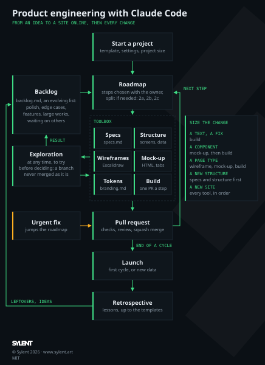

# ts-svelte-idealan

Idealan (« idée » + « LAN ») is a small web application for a LAN party between friends: before the event, each friend pastes the link of a Steam game they would like to play into a shared bag; on the day, the group opens the page and picks what to play.

Built with Svelte 5 and Vite in TypeScript, Netlify Functions and Netlify Blobs, hosted on Netlify. The project follows the conventions and the process of [ts-astro-static-website-template](https://github.com/aunimhsn/ts-astro-static-website-template) and [rust-cli-template](https://github.com/aunimhsn/rust-cli-template); at the end of its first cycle, it becomes the template `ts-svelte-dynamic-website-template`.



## Status

The documents of the project are ready; the code starts with step 0 of [roadmap.md](roadmap.md), the setup, done with Claude Code.

## What it contains

| File | Content |
|---|---|
| `process.md`, `docs/process.svg` | How the application goes from an idea to online and keeps growing: a toolbox (specifications, structure, wireframes, mock-up, design system, build, launch, retrospective) picked for each change, a backlog and a roadmap, the urgent fixes and the explorations. |
| `CLAUDE.md` | Rules for Claude Code: communication, the project, naming, language and French typography, specifications and roadmap, Git workflow, commit messages, code review, checks, deployment. |
| `specs.md` | The starting notes of the idea, and the skeleton of the specifications. |
| `roadmap.md`, `backlog.md` | The steps of the first cycle, and the ideas noted for later. |
| `docs/technical-choices.md` | The stack and its reasons, the use of Steam, the commands, the naming exceptions. |
| `docs/external-services.md` | Netlify and the Steam Store: what to check of their limits and terms, and the risks accepted by the owner. |
| `docs/branding.md` | The visual identity and every design decision, with the tokens. |
| `design-journal.md` | The design experiences of past projects: a source of ideas, not rules. |
| `.claude/agents/` | The `code-reviewer` and `dependency-reviewer` subagents, which write their notes, in French, to `outputs/`. |
| `.claude/skills/` | The `excalidraw-wireframes` and `html-mockups` skills. |
| `.claude/settings.json` | The claude.ai connectors turned off and the unused skills hidden from the model, to save tokens. |
| `inputs/`, `outputs/` | Untracked working folders: temporary references given to Claude Code, and temporary files it produces (see `CLAUDE.md`). |

## Start

1. Set the pull request settings: allow only squash merging, and delete the branches once merged:

   ```sh
   gh repo edit --enable-squash-merge --enable-merge-commit=false --enable-rebase-merge=false --delete-branch-on-merge
   ```

2. Protect `main` (**Settings › Rules › Rulesets**): require a pull request, block force pushes and deletion; the CI check is added once step 0 has created it.
3. Open Claude Code in the project folder and ask it to start step 0 of [roadmap.md](roadmap.md).

## Requirements

- Node.js LTS and npm (version pinned at step 0)
- The Netlify CLI (`npm install -g netlify-cli`), for `netlify dev`
- Python 3, for the skills (wireframes and mock-up server)
- Firefox, for the headless screenshots of the mock-up

## Development

The commands are set up at step 0 and listed in [docs/technical-choices.md](docs/technical-choices.md#commands).

## Deployment

Netlify deploys every merge into `main`, and every pull request gets a deploy preview. The application lives at its `netlify.app` address; the access code is an environment variable of the Netlify site.

## License

[MIT](LICENSE)
